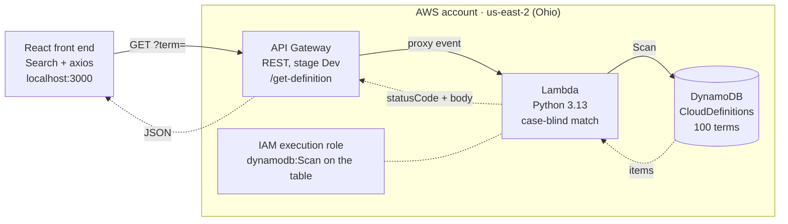

# Serverless Cloud Dictionary — Project Overview

## Overview

Cloud Dictionary is a serverless web app. You type a cloud term, such as "Virtualization", and it returns the definition. It runs entirely on managed AWS services in **us-east-2 (Ohio)**, so there are no servers to manage.

| Layer | Service | What it does |
| --- | --- | --- |
| Front end | React 19 (Create React App) + axios | Search box that calls the API |
| API | Amazon API Gateway (REST, stage `Dev`) | Exposes `GET /get-definition?term=...` |
| Compute | AWS Lambda (Python 3.13), `FetchTermFromDynamoDB` | Finds the term, ignoring case and extra spaces |
| Data | Amazon DynamoDB table `CloudDefinitions` | Stores 100 terms (`term` and `definition`) |
| Access | AWS IAM role | Lets Lambda scan the table and write logs |

## Architecture



The browser calls API Gateway, which passes the request to Lambda. Lambda scans `CloudDefinitions` and returns 200, 404 or 400 with CORS headers.

## Repository layout

| Path | Purpose |
| --- | --- |
| `src/App.js` | React UI. Holds `apiUrl`, the API Gateway invoke URL |
| `src/App.css`, `src/index.js` | Styling and React entry point |
| `src/lambda/lambda_function.py` | Lambda handler `lambda_handler`, deployed to `FetchTermFromDynamoDB` |
| `records/records-1.json` to `records-4.json` | 4 files of 25 terms each, in `batch-write-item` format |
| `public/` | Static HTML shell and icons |
| `package.json` | npm scripts: `start`, `build`, `test` |
| `.gitignore` | Keeps `node_modules/`, `build/`, `.env`, `__pycache__/` out of git |

## Prerequisites

- [ ] An AWS account with console access, working in region **us-east-2 (Ohio)**
- [ ] AWS CLI v2 installed and set up with `aws configure`, with **Default region name** set to `us-east-2`
- [ ] Node.js 18 or later and npm
- [ ] Git, and a GitHub account (`shakilawal1985`)
- [ ] A local clone of the repository

## Setup steps

Do these in order. Every resource must be in **us-east-2**.

### Step 1: Create the DynamoDB table

1. Open **DynamoDB**, choose **Tables**, then **Create table**.
2. Set **Table name** to `CloudDefinitions` and **Partition key** to `term` (String).
3. Keep the default settings and click **Create table**. Wait until the status is **Active**.

### Step 2: Load the 100 terms

Each records file holds 25 items, which is the most a single `batch-write-item` call accepts. From the project folder, run:

```bash
for f in records/records-*.json; do
  aws dynamodb batch-write-item --request-items file://$f --region us-east-2
done
```

Each run should print `"UnprocessedItems": {}`. In the console, open **Explore items**, select `CloudDefinitions`, and click **Run**. You should see 100 items.

### Step 3: Create the Lambda function

1. Open **Lambda** and click **Create function**. Choose **Author from scratch**.
2. Set **Function name** to `FetchTermFromDynamoDB` and **Runtime** to **Python 3.13**. Do not pick Node.js.
3. Click **Create function**.
4. In the code editor, make sure the file is named `lambda_function.py`. Paste the code from `src/lambda/lambda_function.py` into it.
5. Under **Runtime settings**, click **Edit** and set **Handler** to `lambda_function.lambda_handler`.
6. Click **Deploy**.

### Step 4: Give Lambda access to the table

1. Go to **Configuration**, then **Permissions**, and open the execution role.
2. Click **Add permissions**, then **Create inline policy**, and paste this policy (replace `<account-id>`):

```json
{
  "Version": "2012-10-17",
  "Statement": [{
    "Effect": "Allow",
    "Action": ["dynamodb:Scan", "dynamodb:GetItem"],
    "Resource": "arn:aws:dynamodb:us-east-2:<account-id>:table/CloudDefinitions"
  }]
}
```

The function uses `Scan`, so it can match terms whatever their case or spacing. Without `dynamodb:Scan` it fails with `AccessDeniedException`.

### Step 5: Create the API in API Gateway

1. Open **API Gateway** and choose **REST API**, then **Build**. Name it `CloudDictionaryAPI`.
2. Create a resource `get-definition`, then a **GET** method on it.
3. Set the integration type to **Lambda function**, turn on **Lambda proxy integration**, and pick `FetchTermFromDynamoDB`.
4. Select the `get-definition` resource and click **Enable CORS**. Tick `GET` and `OPTIONS`.
5. Click **Deploy API**, create a new stage named `Dev`, and deploy.
6. Copy the **Invoke URL**. It looks like `https://<api-id>.execute-api.us-east-2.amazonaws.com/Dev`.

### Step 6: Connect and run the React front end

1. In `src/App.js`, set `apiUrl` to your invoke URL. Do not add a trailing slash.
2. Install dependencies and start the app:

   ```bash
   npm install
   npm start
   ```

3. Open `http://localhost:3000`, type a term, and click **Search**.
4. Optional: run `npm run build` and host the `build/` folder, for example on S3 static website hosting or AWS Amplify.

### Step 7: Push to GitHub

Set your git identity once, then commit and push:

```bash
git config --global user.name "SM Awal"
git config --global user.email "<your GitHub email>"
git add .
git commit -m "Describe your change"
git push
```

`origin` already points to `shakilawal1985/serverless-cloud-dictionary`. Check that `node_modules/` never appears in `git status` before you commit.

## Testing

Test each layer from the bottom up, so you know exactly where something breaks.

**1. Lambda console test.** Create a test event:

```json
{ "queryStringParameters": { "term": "virtualization" } }
```

| Input `term` | Expected `statusCode` | Expected body |
| --- | --- | --- |
| `virtualization` (any case, extra spaces) | 200 | The stored term and its definition |
| `NotARealTerm` | 404 | `{"message": "Term not found"}` |
| empty or missing | 400 | `{"message": "term is required"}` |

**2. API test from a terminal:**

```bash
curl "https://<api-id>.execute-api.us-east-2.amazonaws.com/Dev/get-definition?term=Virtualization"
```

**3. Front-end test.** Search in the browser and open DevTools (Console and Network tabs). The request should return 200, and the definition card should appear.

## Troubleshooting

These are the errors hit while building this project, and their fixes.

| Error | Cause | Fix |
| --- | --- | --- |
| `SyntaxError: Unexpected token 'import'` with `node:internal/modules/esm` | Function created with a Node.js runtime but given Python code | **Runtime settings**: set Runtime to Python 3.13, then Deploy |
| `Unable to import module 'index'` | Handler still set to the Node.js default `index.handler` | Set Handler to `lambda_function.lambda_handler` |
| `ResourceNotFoundException` | CLI or Lambda pointed at a different region from the table | Use `us-east-2` everywhere (`aws configure` or `--region us-east-2`) |
| `AccessDeniedException` on `Scan` | Execution role lacks DynamoDB permission | Add the Step 4 inline policy |
| Browser shows a CORS error | CORS not enabled, or the API not redeployed after enabling it | Enable CORS on `get-definition`, then **Deploy API** to `Dev` again |
| `403 Permission ... denied to shakilawal1985` on `git push` | `origin` pointed at someone else's repo | `git remote set-url origin https://github.com/shakilawal1985/serverless-cloud-dictionary.git` |
| `HTTP 400` / `RPC failed` on `git push` | `node_modules/` committed, which makes the push too large | Untrack it with `git rm -r --cached node_modules` and keep it in `.gitignore` |
| "Your name and email address were configured automatically" | Git identity not set | `git config --global user.name` / `user.email` |
| Lambda test shows old behaviour | Code edited but not deployed (**Undeployed** badge) | Click **Deploy** before **Test** |

## Cleanup

Delete these when you finish the lab, so they don't keep costing money or stay exposed. All are in us-east-2.

- [ ] API Gateway: delete `CloudDictionaryAPI`
- [ ] Lambda: delete `FetchTermFromDynamoDB`
- [ ] DynamoDB: delete the `CloudDefinitions` table
- [ ] IAM: delete the Lambda execution role
- [ ] CloudWatch Logs: delete the `/aws/lambda/FetchTermFromDynamoDB` log group
- [ ] S3 or Amplify: delete the front-end hosting, if you set it up
